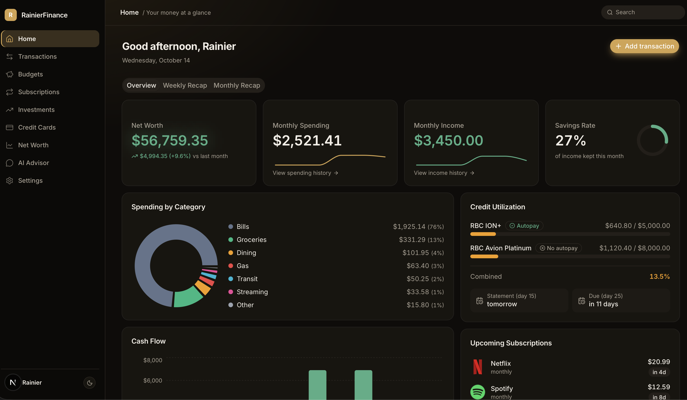
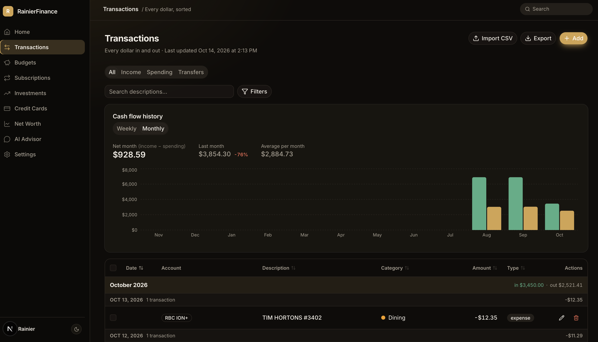

# RainierFinance

A full-stack personal finance dashboard that syncs your bank accounts (and takes brokerage and crypto exports) into one clear picture of where your money goes — with an AI advisor that answers questions about **your** actual numbers.

Built for the Canadian banking stack I use every day (RBC, Wealthsimple, Coinbase), in CAD.




## Features

- **Automatic bank sync (Plaid)** — connect RBC or another bank once; transactions and balances sync on their own, with up to two years of history on the first sync. Pending charges update in place when they post, and connecting an account you'd already filled from CSVs picks up after your last imported day instead of double-counting.
- **CSV import as a fallback** — parsers for RBC (chequing + Visa), Wealthsimple holdings reports, and Coinbase transaction history, with duplicate detection so re-importing the same file never double-counts.
- **Automatic categorization** — a rule-based merchant categorizer that learns from your corrections, detection of internal transfers so moving money between accounts isn't counted as spending, and refund detection so money back lowers spending instead of counting as income.
- **Insights** — where income goes (fixed bills, essentials, wants, saved), savings rate over time, 12-month category trends, top merchants with per-merchant history, and habits such as weekday spending and small purchases.
- **Daily guidance** — a "safe to spend today" number, a fixed / essentials / discretionary split paced against last month, "what changed" in each recap, and an alerts bell for budgets, renewals, and price increases.
- **Goals & challenges** — savings goals with the monthly pace a deadline needs, emergency-fund runway, and monthly challenges (category caps, no-spend days).
- **Subscription detection** — flags recurring charges (same merchant, same amount) and tracks upcoming billing dates.
- **Budgets** — weekly, monthly, and yearly budgets with spending computed live from transactions, and suggested amounts from your own history.
- **Investments & crypto** — holdings, allocation charts, a portfolio health grade (single-stock concentration, overlapping ETFs), and live crypto prices converted to CAD.
- **Credit cards** — utilization tracking, payment schedule, and a "which card should I use?" recommender per spending category.
- **Net worth** — snapshots over time with an asset/liability breakdown.
- **Weekly & monthly recap** — budget progress, subscriptions charged, biggest transactions, and net worth change for the period.
- **AI Advisor** — a chat assistant powered by Claude that is grounded in the signed-in user's own transactions, budgets, and holdings, with streamed responses.

## Tech Stack

| Layer | Tools |
|---|---|
| Frontend | Next.js 15 (App Router), React 19, TypeScript, Tailwind CSS 4, shadcn/ui, Recharts |
| Data fetching & state | TanStack Query, Zustand, React Hook Form + Zod |
| Backend & database | Supabase (PostgreSQL, Auth, Row-Level Security) |
| AI service | Python, FastAPI, Anthropic Claude API |
| Testing | Vitest |

## Architecture

```
Browser (Next.js app)
  ├── Supabase  ── Postgres + Auth; Row-Level Security on every table
  ├── /api/crypto/prices  ── Next.js route, authenticated proxy to Coinbase public prices
  ├── /api/plaid/*  ── Next.js routes for bank sync
  │     ├── link-token, exchange  ── connect a bank through Plaid Link
  │     ├── sync  ── /transactions/sync with a saved cursor → categorize → upsert
  │     └── webhook  ── Plaid-signed (JWT) push when new transactions are ready
  └── FastAPI service (api/)  ── AI Advisor
        ├── verifies the user's Supabase JWT
        ├── loads that user's financial data server-side
        └── streams a Claude response grounded in it
```

Each feature follows the same path: **page** (`app/`) → **components** (`components/`) → **data hook** (`lib/hooks/`) → **Supabase**. Pure business logic — CSV parsers, categorization, budgets, subscription detection — lives in `lib/` with unit tests alongside it.

### Security decisions

- **Bank tokens are server-only and encrypted** — Plaid access tokens are AES-256-GCM encrypted with a key that lives only in the server environment, and sit in a table with RLS enabled and no policies, so the browser can't read them even encrypted. Users sign in on their bank's own page through Plaid Link; the app never sees bank passwords. Webhooks are rejected unless Plaid's signature over the exact body verifies.
- **Row-Level Security** on all 12 tables — users can only ever read or write their own rows, enforced by the database rather than application code.
- **API keys stay server-side** — the Anthropic key and Supabase service-role key exist only in the Python service; the browser never sees them.
- **Authenticated endpoints** — the AI service and the price proxy both reject unauthenticated requests, and chat is rate-limited per user.

## Project Structure

```
app/            Pages and routes (one folder per page)
components/     UI, grouped by feature (transactions/, budgets/, ...)
lib/hooks/      Data access — all Supabase reads/writes
lib/parsers/    RBC, Wealthsimple, and Coinbase CSV parsers
lib/utils/      Business logic: categorization, budgets, dates, aggregation
api/            Python FastAPI service for the AI Advisor
supabase/       Database migrations
scripts/        Seed and reset scripts for local development
```

## Running Locally

**Prerequisites:** Node.js 20+, Python 3.11+, a [Supabase](https://supabase.com) project, and an [Anthropic API key](https://console.anthropic.com) (only needed for the AI Advisor).

1. **Install dependencies**
   ```bash
   npm install
   cd api && python3 -m venv .venv && .venv/bin/pip install -r requirements.txt && cd ..
   ```

2. **Set up the database** — run the SQL files in `supabase/migrations/` in order in your Supabase project's SQL editor.

3. **Add environment variables** — create `.env.local` in the project root:
   ```
   NEXT_PUBLIC_SUPABASE_URL=
   NEXT_PUBLIC_SUPABASE_ANON_KEY=
   SUPABASE_SERVICE_ROLE_KEY=
   ANTHROPIC_API_KEY=
   ANTHROPIC_MODEL=
   NEXT_PUBLIC_PYTHON_API_URL=http://localhost:8000
   PLAID_CLIENT_ID=
   PLAID_SECRET=
   PLAID_ENV=sandbox
   PLAID_TOKEN_KEY=        # openssl rand -base64 32
   PLAID_WEBHOOK_URL=      # optional
   ```

   **Bank sync:** sign up at [dashboard.plaid.com](https://dashboard.plaid.com) and copy the client ID and Sandbox secret from Developers → Keys. In Sandbox, connect any test bank with username `user_good` and password `pass_good`. To sync your real accounts, request Production access in the Plaid Dashboard, then switch `PLAID_ENV=production` and use the Production secret. Without `PLAID_WEBHOOK_URL` (it must be a public URL, so not localhost), the app syncs whenever you open it after 4 hours and when you press **Sync**.

4. **Seed demo data** (optional) — creates a dev user with realistic sample transactions. Set `SEED_DEV_PASSWORD` (12+ characters) in `.env.local` first:
   ```bash
   npm run seed
   ```

5. **Start both servers**
   ```bash
   npm run dev
   cd api && .venv/bin/uvicorn main:app --port 8000
   ```
   Then open [http://localhost:3000](http://localhost:3000).

## Tests

```bash
npm test                                         # unit tests (Vitest)
cd api && python -m unittest test_insights       # AI Advisor insight math
npm run test:e2e                                 # browser tests (Playwright)
```

Unit tests cover the CSV parsers, Plaid transaction mapping and token encryption, categorization and refund detection, budget and goal math, spending insights, challenges, alerts, and subscription detection.

The end-to-end tests run against the Supabase project in `.env.local`: they create a throwaway user with synthetic data, sign in, exercise the main flows (dashboard, insights, refunds, budgets, alerts, subscriptions), and delete the user afterwards. They never touch your own account. CI (`.github/workflows/ci.yml`) runs lint, types, and unit tests on every push; the end-to-end job runs once you add the Supabase secrets and set the `E2E_ENABLED` repository variable.
